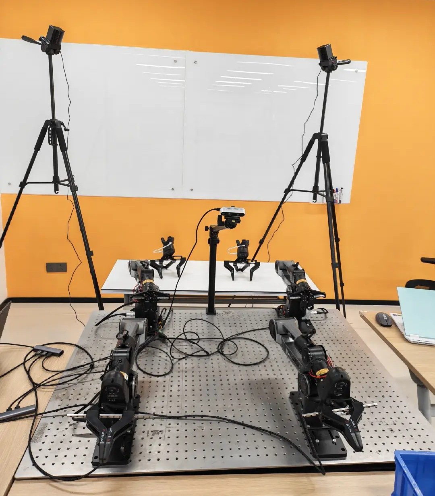
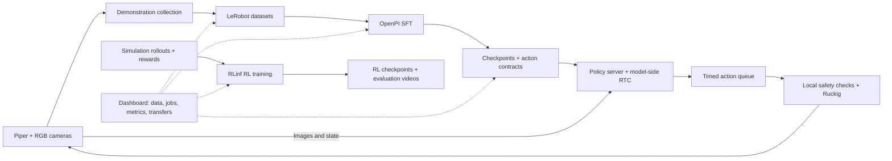
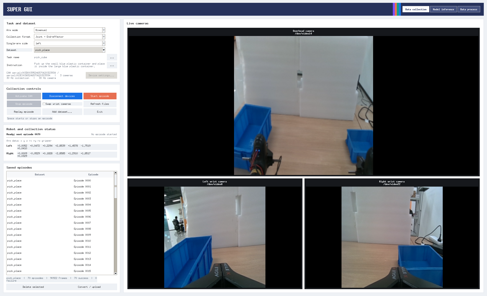
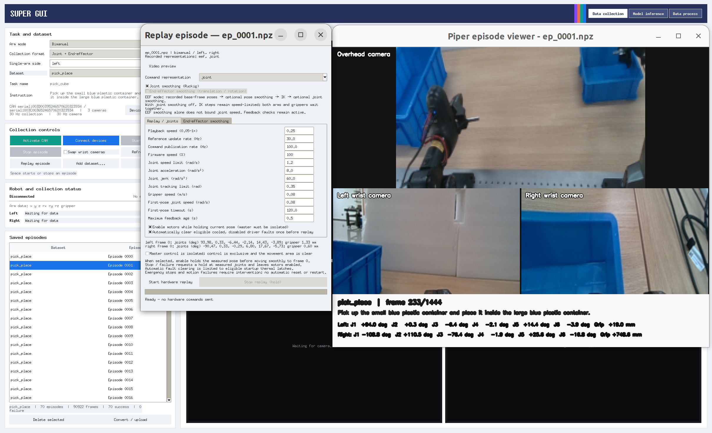
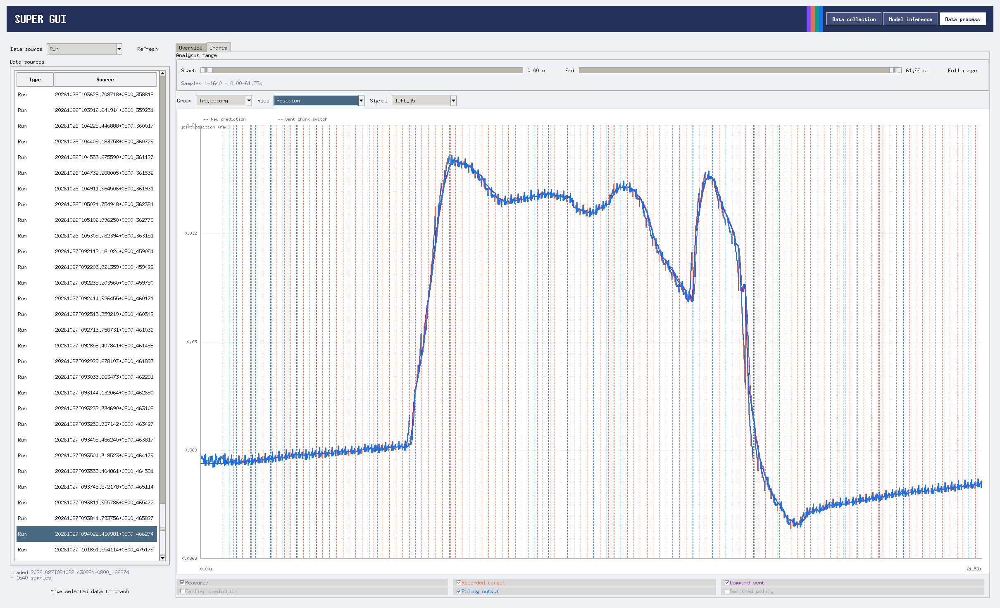
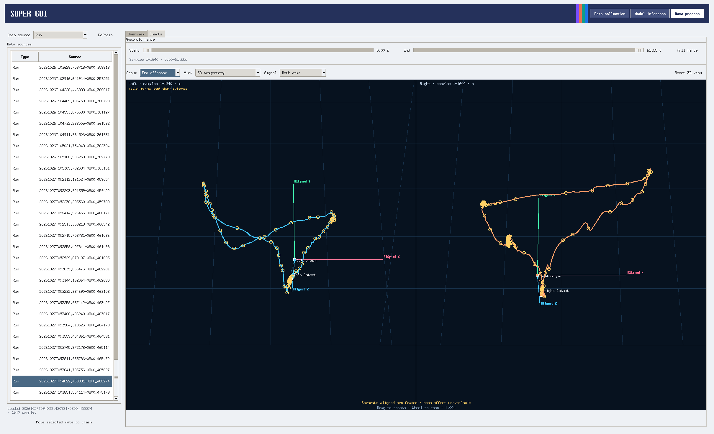
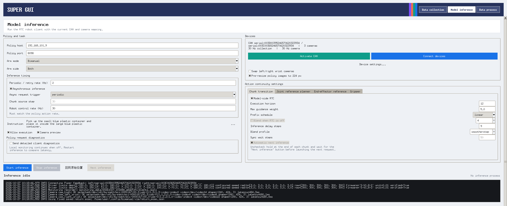
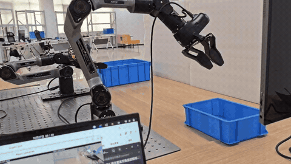
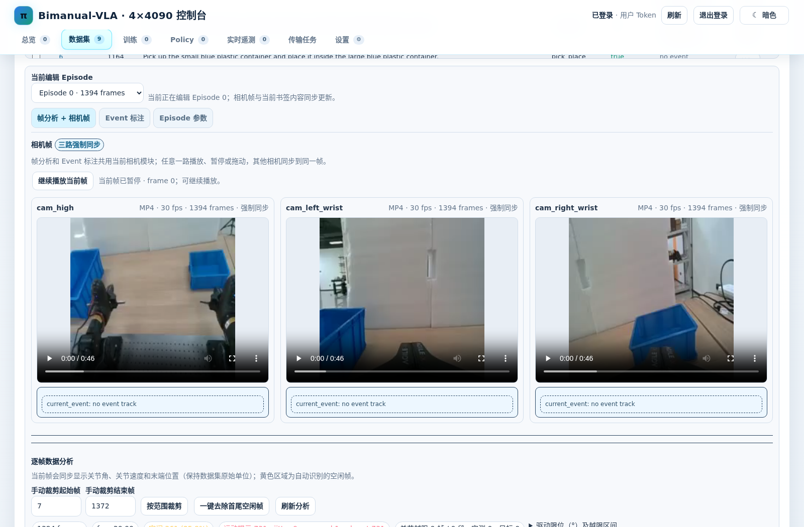
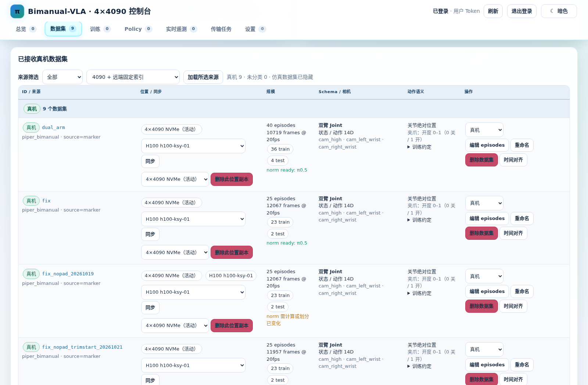

<div align="center">

# bimanual-vla

**Piper robot data collection, multi-node data management, SFT / RL training, and real-time deployment**

[](docs/INSTALLATION.md) [](docs/INSTALLATION.md) [](https://github.com/huggingface/lerobot) [](https://github.com/Physical-Intelligence/openpi) [](#real-robot-deployment)

[**Code**](https://github.com/SUNNYsyy2005/bimanual-vla) &nbsp;&middot;&nbsp; [**Documentation**](docs/README.md) &nbsp;&middot;&nbsp; [**Demo**](#demo) &nbsp;&middot;&nbsp; [**Models & Datasets**](#released-models-and-datasets) &nbsp;&middot;&nbsp; [**Installation**](docs/INSTALLATION.md)

</div>

<p align="center">
  
  <br>
  <em>Real-robot system. Pika devices shown are awaiting integration（Pika 设备待接入）.</em>
</p>

## Overview

`bimanual-vla` connects the complete real-robot learning loop in one repository:
collect synchronized Piper demonstrations, validate and export LeRobot datasets,
manage datasets and checkpoints across workstations and GPU clusters, fine-tune
OpenPI `pi0` / `pi0.5` policies, and deploy action chunks through a latency-aware
execution stack with local safety checks.

Training workflows cover **supervised fine-tuning (SFT)** with OpenPI and
**reinforcement learning (RL)** through the simulation Dashboard's RLinf
integration, with shared experiment, checkpoint, and evaluation-video management.

```text
Piper + RGB Cameras  ->  Robot Demonstrations  ->  LeRobot Dataset
        ->  OpenPI Fine-tuning  ->  Policy Server
        ->  Real-Time Chunking  ->  Safety Layer  ->  Piper Execution
```

The workflow supports single-arm and bimanual Piper operation, joint-space and
end-effector (`delivery`) data contracts, and GUI/CLI workflows. Deployment
behavior depends on the active Policy contract and hardware configuration.

## Highlights

- **End-to-end real-robot pipeline** from demonstrations to closed-loop policy execution.
- **Multi-camera Piper collection** with GUI operation, teleoperation, replay, and episode management.
- **LeRobot-compatible data** with versioned contracts, validation, conversion, and upload tools.
- **Multi-node Dashboard** for dataset locations and transfers, checkpoint synchronization, training jobs, metrics, and evaluation videos.
- **SFT and RL workflows**: OpenPI supervised fine-tuning with configurable full/LoRA tuning and π0.5 RTC training; RLinf integration for simulation RL training and evaluation.
- **Real-time, safety-aware deployment** with model-side RTC, asynchronous inference, an independent Ruckig command loop, and local execution checks.

## System Overview



The public workflow is organized into three stages. Detailed data contracts,
validation rules, transport fields, and server operations live in
[the documentation](docs/README.md) instead of the project homepage.

| Stage | Input | Core components | Output |
|---|---|---|---|
| Data collection | Piper feedback, RGB views, language instruction | GUI or teleoperation, synchronized recording, episode validation | Raw robot episodes and LeRobot v2.1 datasets |
| VLA training | Demonstrations for SFT; simulation rollouts/rewards for RL | OpenPI SFT, RLinf RL profiles, local/Slurm job management | Checkpoints, metrics, and evaluation artifacts |
| Real-time deployment | Live observation and Policy checkpoint | Asynchronous WebSocket inference, model-side RTC, action queues, safety gates | Validated Piper commands at the configured control rate |

## Hardware Setup

### Robot and Sensors

| Component | Configuration |
|---|---|
| Robot | Piper robotic arm, single-arm or bimanual |
| Kinematics | 6 revolute joints per arm plus gripper |
| End effector | Piper gripper, approximately `0.00-0.07 m` opening range |
| Control | Piper SDK over SocketCAN at `1 Mbit/s` |
| Overhead camera | Intel RealSense D435i, third-person RGB view |
| Wrist cameras | Intel RealSense D405, one RGB view per active wrist |
| Collection rate | Configurable; GUI defaults to `30 FPS`, teleoperation CLI to `20 FPS` |
| Policy reference / command publication | Default `20 Hz` reference updates and `100 Hz` Ruckig command publication; configurable |
| Camera source rate | Typically `30 FPS` |

Depth is available on the camera hardware but is not part of the current
training contract. Stable `/dev/v4l/by-path` camera selectors are recommended
because `/dev/videoN` indices can change after USB reconnection.

### Compute

| Role | Typical platform | Responsibility |
|---|---|---|
| Robot workstation | Ubuntu 22.04, x86_64 | CAN control, camera capture, GUI, RTC client |
| Policy and Dashboard server | NVIDIA RTX 4090 workstation | Multi-node data management, Policy inference, telemetry, simulation evaluation |
| Training cluster | NVIDIA H100 / H200 with Slurm | Multi-GPU fine-tuning and evaluation |

ROS, ROS2, gRPC, and EtherCAT are not required by the current stack.

## Data Collection

<p align="center">
  
</p>

The collection application provides device discovery, live multi-camera
preview, task metadata, robot feedback, episode controls, replay, and direct
conversion/upload. It supports:

- single-arm and bimanual collection;
- master/slave teleoperation or output-arm feedback recording;
- overhead plus left/right wrist RGB streams;
- `joint` and `delivery` data schemas;
- success/failure labeling and guarded episode publication.

<details>
<summary>Episode preview and hardware replay</summary>

<p align="center">
  
</p>

Recorded episodes support synchronized camera playback and supervised hardware
replay with joint or EEF commands. See the
[episode replay guide](docs/collection/EPISODE_HARDWARE_REPLAY.md).

</details>

Start the GUI from the robot workstation:

```bash
conda activate dual_arm
bash start_gui.sh
```

For command-line bimanual teleoperation and recording:

```bash
bin/bimanual-vla teleop-bimanual --record --schema joint
```

See the [GUI operation guide](docs/collection/GUI_OPERATION_GUIDE.md) and
[data collection guide](docs/collection/DATA_COLLECTION_GUIDE.md) before
connecting hardware.

## Dataset Pipeline

```text
Raw NPZ Episodes  ->  Contract Validation  ->  LeRobot v2.1
       ->  Dataset Inspection / Merge  ->  OpenPI Training Dataset
```

Each episode combines the signals needed by a vision-language-action policy:

| Signal | Content |
|---|---|
| RGB observations | Overhead view and one or two wrist views |
| Robot state | Joint state or absolute end-effector state |
| Actions | Joint targets or end-effector targets / model deltas |
| Language | Natural-language task instruction |
| Metadata | Timestamps, schema, arm mode, contract version, success label |

Supported v3 action contracts are explicit and versioned:

| Mode | Schema | Observation | Raw action | Model action |
|---|---|---:|---:|---:|
| Single arm | Joint | 7D | 7D | 7D |
| Bimanual | Joint | 14D | 14D | 14D |
| Single arm | Delivery | 10D | 10D | 7D |
| Bimanual | Delivery | 20D | 20D | 14D |

Bimanual vectors always use `left + right` ordering, and the normalized gripper
convention is `0 = closed`, `1 = open`.

```bash
# Validate raw episodes
bin/bimanual-vla data-validate \
  --input-dir episodes_piper_v21 \
  --target-fps 20

# Export successful episodes to LeRobot v2.1
bin/bimanual-vla data-export \
  --input-dir episodes_piper_v21 \
  --repo-id piper/piper_v1 \
  --root lerobot_datasets/piper_v1 \
  --fps 20

# Validate the exported dataset
bin/bimanual-vla data-check lerobot_datasets/piper_v1
```

The authoritative field definitions are documented in the
[Piper data contract](docs/collection/PIPER_DATA_CONTRACT.md).

<details>
<summary>Client-side trajectory and end-effector analysis</summary>

<p align="center">
  
  
</p>

The data-processing tab compares available measured, predicted, and sent
trajectories, marks chunk transitions, and visualizes both arms' EEF paths.

</details>

## VLA Training

The platform supports two training modes:

| Mode | Backend and inputs | Supported workflow |
|---|---|---|
| **SFT — supervised fine-tuning** | OpenPI `pi0` / `pi0.5` and LeRobot demonstrations | Normalization, train/test splits, configurable fine-tuning, FSDP, checkpointing, and held-out evaluation |
| **RL — reinforcement learning** | RLinf and configured simulation environments/reward functions | Launch configured algorithm profiles, monitor rollout/training metrics, manage checkpoints, and evaluate/review rollout videos |

RL runs through the **simulation Dashboard** and requires a configured RLinf
environment, launch profile, and execution target. Algorithm availability is
defined by those profiles. Both modes expose task logs and experiment artifacts;
the pick-and-place weights linked below are **SFT checkpoints**.

For SFT, the backend integrates OpenPI `pi0` and `pi0.5` with independently
configurable action-expert, language-model, and vision-encoder tuning. The
π0.5 path also supports training-time RTC prefix conditioning.
The Dashboard manages dataset selection, persistent train/test splits,
normalization statistics, training jobs, checkpoints, and held-out evaluation.
FSDP can distribute supported runs across multiple GPUs; H100/H200 jobs are
submitted through Slurm.

```yaml
Input:
  Images: overhead RGB + wrist RGB views
  State: joint 7D/14D or end-effector 10D/20D
  Language: natural-language task instruction

Output:
  Action chunk: 50 x 7D or 50 x 14D
  Execution target: schema-dependent decoded action with safety checks
```

Download an OpenPI base checkpoint with the repository helper:

```bash
python -m scripts.models.download_openpi_checkpoint \
  --checkpoint gs://openpi-assets/checkpoints/pi05_base \
  --source auto \
  --workers 16 \
  --chunks-per-file 16
```

Training and Policy serving use a separate OpenPI Python 3.11 environment. Do
not install the robot workstation requirements over a working JAX/OpenPI
environment. Follow the [installation guide](docs/INSTALLATION.md#9-openpi-policy-and-training-server)
for the pinned upstream revision and server configuration.

## Real-Robot Deployment

<p align="center">
  
</p>

```text
Robot Workstation                         Policy Server
-----------------                        -----------------
RGB cameras + Piper state  --WebSocket-> OpenPI pi0 / pi0.5
RTC session and timing      --WebSocket-> Model-side RTC
Action queue + safety       <-WebSocket-- Timestamped action chunk
        |
        +--> Reference updates --> Ruckig --> Validated Piper commands
```

Start the Dashboard/Policy stack on a configured inference server, then run the
robot client in **shadow mode** first:

```bash
export BIMANUAL_VLA_POLICY_HOST="<policy-server-host>"

bin/bimanual-vla rtc-client \
  --host "$BIMANUAL_VLA_POLICY_HOST" \
  --port 8000 \
  --arm-mode bimanual \
  --arm-side both \
  --left-can can0 \
  --right-can can1 \
  --cam-high-device auto \
  --cam-left-wrist-device auto \
  --cam-right-wrist-device auto \
  --instruction "pick up the cube" \
  --hz 4 \
  --control-hz 20 \
  --rtc-enabled
```

> [!CAUTION]
> Real motion requires the local `--allow-execution` flag and valid robot,
> observation, and Policy state. Stale inputs, a contract mismatch, or a failed
> safety check block execution or trigger the configured hold/braking behavior.

The execution layer validates action age and shape, workspace bounds, joint and
gripper changes, schema-specific IK feasibility, and Piper state before command
publication. RTC is applied inside model denoising.
See the [RTC deployment guide](docs/deployment/RTC_CLIENT_GUIDE.md).

### Inference timing and execution controls

Policy inference, model action timing, reference updates, and actuator command
publication have separate clocks. Reference updates default to `--control-hz 20`;
the Ruckig backend publishes at `--servo-hz 100` by default. Model action timing
comes from Policy metadata (30 Hz for the released pick-and-place checkpoints)
unless explicitly overridden with `--action-hz`. The client supports two
inference scheduling modes:

- `--inference-trigger-mode periodic` (default): attempt a new inference at
  `--hz` (default 4 Hz), with at most one request in flight. Actual throughput
  depends on end-to-end latency.
- `--inference-trigger-mode chunk_step --inference-trigger-step 10`: launch
  the next request when the accepted chunk reaches the specified source step.
  In this mode `--hz` governs initialization/recovery retries rather than
  the normal per-chunk trigger.

The server performs RTC prefix guidance during model denoising. Additional
client-side blending is separate and should be tuned deliberately, not treated
as equivalent to model-side RTC.

The execution path includes configurable joint trajectory shaping and safety
interlocks:

- `--trajectory-shaping` selects the **Ruckig** reference planner by default,
  with velocity, acceleration, jerk, tracking-error, and joint-position limits.
  Use `--servo-backend legacy` for the older low-pass/tracking pipeline or
  `--no-trajectory-shaping` for controlled comparisons.
- `--pose-trajectory` optionally shapes EEF pose references before IK and is
  disabled by default. It requires the Ruckig backend.
- `--blend-profile smootherstep` controls the optional action-boundary blend.
- `--gripper-open-lookahead-steps` can anticipate opening while keeping
  gripper filtering and safety checks active.
- `--reject-external-control-streams` guards against simultaneous
  high-rate Piper control; `--auto-return` is enabled by default for a
  monitored return to the startup pose on normal shutdown.

**Important:** smoothing and motion limits trade tracking responsiveness for
command continuity. Aggressive filtering or lookahead can cause lag or
overshoot; disabling shaping can expose high-frequency joint jitter. Validate
settings in shadow mode and then in a supervised, low-risk hardware test before
normal deployment. Neither mode guarantees the absence of overshoot.

Monitoring and deployment recordings can distinguish raw Policy predictions
from commands actually sent to the robot, including velocity, acceleration,
tracking error, chunk boundaries, and timing. See the
[RTC deployment guide](docs/deployment/RTC_CLIENT_GUIDE.md) for parameters,
diagnostic definitions, and safety prerequisites.

## Demo

<p align="center">
  <a href="https://huggingface.co/SUNNYsyy2005/pi05_pick_place_clean_joint_20261025_20k/resolve/main/media/pick-place-real-robot-20261027.mp4">
    
  </a>
</p>

Successful real-robot pick-and-place demonstration recorded on **October 27, 2026**:
*“Pick up the small blue plastic container and place it inside the large blue
plastic container.”* The preview plays at **4× speed**;
[watch or download the original-speed video](https://huggingface.co/SUNNYsyy2005/pi05_pick_place_clean_joint_20261025_20k/resolve/main/media/pick-place-real-robot-20261027.mp4).

## Released Models and Datasets

The **20,000-step π0.5 checkpoints** and their matching real-robot datasets are
available on Hugging Face in both joint-space and end-effector-space formats:

| Representation | Dataset | Model weights |
|---|---|---|
| Joint space — 14D state / raw action | [pick_place_clean_joint_20261025](https://huggingface.co/datasets/SUNNYsyy2005/pick_place_clean_joint_20261025) | [π0.5 joint · 20k](https://huggingface.co/SUNNYsyy2005/pi05_pick_place_clean_joint_20261025_20k) |
| End-effector space (`delivery`) — 20D state / raw action | [pick_place_clean_delivery_20261025](https://huggingface.co/datasets/SUNNYsyy2005/pick_place_clean_delivery_20261025) | [π0.5 EEF · 20k](https://huggingface.co/SUNNYsyy2005/pi05_pick_place_clean_delivery_20261025_20k) |

Each dataset contains **90 episodes / 69,905 frames at 30 FPS**, with overhead
and left/right wrist RGB views in LeRobot v2.1 format. These are two
representations of the same demonstrations. The actual grouped split is
**81 training / 9 held-out episodes**; use `meta/train_test_split.json` for the
episode indices, as explained in the dataset cards.

Both policies use full vision-encoder and action-expert fine-tuning, language-model
LoRA, and RTC training with delays up to 12 steps. The native OpenPI / Orbax
releases include parameters, normalization statistics, and action contracts.
They contain **inference weights**, without optimizer state for exact training
resumption. See the model cards for download commands and runtime requirements.

## Dashboard

<p align="center">
  
</p>

The Dashboard is the project's **data and experiment management platform**.
Collection workstations upload demonstrations through the GUI, CLI, or REST API;
the web interface tracks their locations and moves the required datasets and
checkpoints between local storage, inference workstations, and configured
H100/H200 Slurm targets.

| Capability | Workflow |
|---|---|
| Multi-node data catalog | Group dataset copies by ID, inspect per-node locations and counts, filter real/simulation sources, and synchronize datasets to a training target |
| Dataset preparation | Resumable uploads, episode and camera previews, metadata editing, merge/trim tools, time-alignment inspection, and persistent train/test splits |
| SFT and RL training | Manage OpenPI SFT and configured RLinf simulation RL runs, submit jobs, inspect GPU resources, and follow task logs, loss/reward curves, and evaluation metrics |
| Checkpoint management | Browse local and remote checkpoints, retain action contracts and normalization assets, and synchronize trained weights to the inference server |
| Deployment and review | Manage Policy processes, inspect live telemetry and trajectories, and browse/synchronize simulation evaluation videos |
| Storage and node settings | Configure data/checkpoint roots and extension nodes for the available workstation and cluster infrastructure |

Real-robot and simulation Dashboards use separate service configurations and
source filters while sharing the underlying management code. H100 and H200
workloads run through Slurm; datasets and environments must be staged on each
node's own storage. The platform exposes the same operations through an
authenticated [REST API](server_4090/API_USAGE.md) for scripted workflows.

<details>
<summary>Multi-node dataset catalog and synchronization</summary>

<p align="center">
  
</p>

</details>

Diagnostics distinguish Policy predictions from commands actually executed by
the robot, with chunk boundaries and timing when recorded. See
[Dashboard operations](server_4090/README.md) and the
[simulation workflow guide](server_4090/SIMULATION_DASHBOARD.md).

## Installation

The robot workstation is tested with Ubuntu 22.04 and Python 3.10:

```bash
git clone https://github.com/SUNNYsyy2005/bimanual-vla.git
cd bimanual-vla

conda create -n dual_arm python=3.10.20 -y
conda activate dual_arm
python -m pip install --upgrade pip setuptools wheel
python -m pip install -r requirements.txt

bin/bimanual-vla --help
```

System packages, SocketCAN activation, RealSense selection, OpenPI setup,
Dashboard configuration, Slurm, verification, and troubleshooting are covered
in the [complete installation guide](docs/INSTALLATION.md).

## Project Layout

```text
.
|-- assets/                    # README images and demos
|-- bin/bimanual-vla          # Unified command entry point
|-- bimanual_vla/
|   |-- collection/           # GUI, cameras, teleoperation, robot sessions
|   |-- data/                 # Contracts, validation, export, upload, analysis
|   |-- deployment/           # RTC client, Ruckig, Policy adapters, safety
|   `-- training/             # OpenPI model, fine-tuning settings, RTC sampling
|-- server_4090/              # Dashboard backend, frontend, Policy services
|-- docs/                     # Installation, collection, and deployment guides
|-- scripts/                  # Model, maintenance, analysis, and smoke tools
|-- jobs/                     # Slurm and analysis jobs
|-- tests/                    # Automated test suite
`-- requirements.txt          # Robot workstation dependencies
```

Runtime datasets, checkpoints, telemetry, and deployment recordings are not
source code and are excluded from Git.

## Documentation

| Topic | Guide |
|---|---|
| Installation and hardware | [Installation](docs/INSTALLATION.md) |
| Collection GUI | [GUI operation guide](docs/collection/GUI_OPERATION_GUIDE.md) |
| Data collection | [Data collection guide](docs/collection/DATA_COLLECTION_GUIDE.md) |
| Dataset fields and semantics | [Piper data contract](docs/collection/PIPER_DATA_CONTRACT.md) |
| 7D/10D action design | [OpenPI action design](docs/collection/PI05_PIPER_7D_10D_DATA_ACTION_DESIGN.md) |
| Real-robot inference | [RTC client guide](docs/deployment/RTC_CLIENT_GUIDE.md) |
| RLSOK device review integration | [RLSOK integration guide](docs/rlsok/README.md) |
| Dashboard backend | [Dashboard operations](server_4090/README.md) |
| Dashboard API | [API reference](server_4090/API_USAGE.md) |
| Simulation data, training, and videos | [Simulation Dashboard](server_4090/SIMULATION_DASHBOARD.md) |

## Testing

```bash
python -m unittest discover -s tests -v
```

Hardware and Policy smoke tests are available under `scripts/smoke/`. Run them
only in the matching robot or inference-server environment.

## Acknowledgements

This project builds on [OpenPI](https://github.com/Physical-Intelligence/openpi),
[LeRobot](https://github.com/huggingface/lerobot), and the Piper robot SDK.
