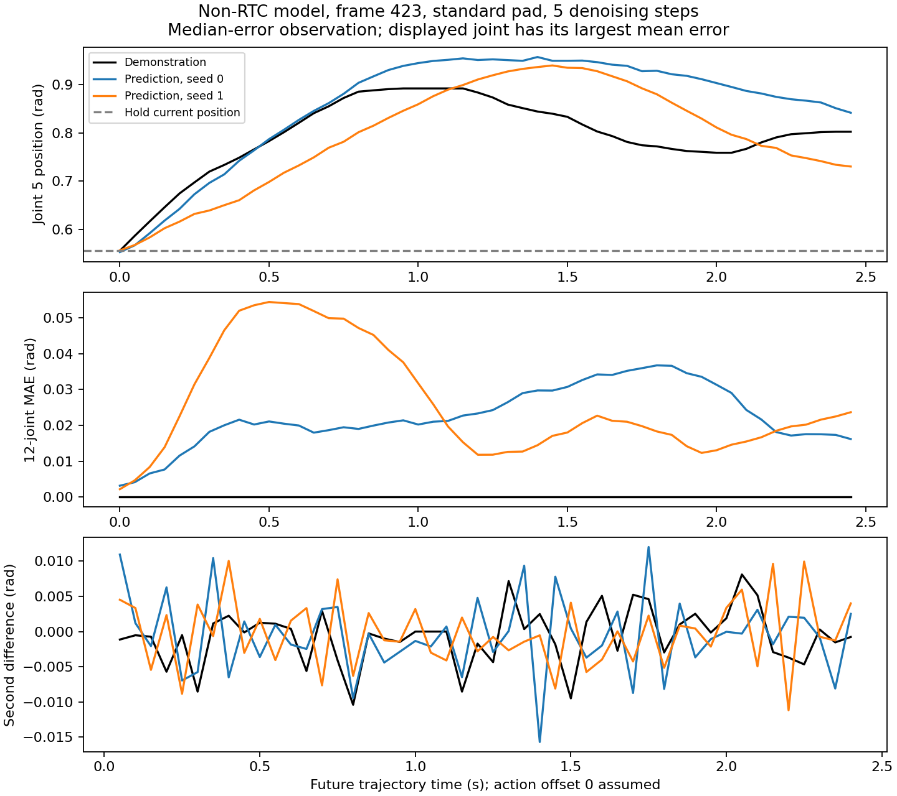

# arrangeblocks 非 RTC 模型离线对照（2026-10-22）

在给定 episode 的抽样观测上，按标准 Aloha/π0.5 预处理假设，预测前 5 步关节 MAE 为 **0.00542 rad**，整段 50 步为 **0.03450 rad**；保持当前位置的整段 MAE 为 **0.07718 rad**。模型整体有预测能力，但远期预测、不同随机种子的输出仍有明显差异。输出高频分量与初始噪声的相关系数约 **0.452**，与当前 RTC 模型测到的约 **0.98** 不同。

**这是单条参考 episode 上的离线预测误差，不能认证为独立测试集成绩，也不等价于闭环抓取成功率。** 权重目录没有原训练配置；下述预处理是根据参数结构、norm 和标准实现重建的假设。没有修改线上模型、客户端或机械臂，也没有添加输出滤波。

## 输入与方法

- 模型：4×4090 `/home/sunny/Desktop/piper_pi05_arrangeblocks/29999`。
- 原始样本：`/home/user/Downloads/episode_0.npz`，1132 帧、20 Hz、三路 640×480 RGB 图像。
- 原提示词直接来自样本：`Move the lower-right block to the center, then move the lower-left block to the center. Stack the upper-left block on top of them, then stack the upper-right block on top.`
- 24 个均匀抽样观测，帧号见 [summary.json](summary.json)；每个观测使用两个相同的对照随机种子 0/1，分别运行 5/10 次去噪。
- 每次只提供该时刻的图像、状态、提示词；未来示范仅供评分，不作为模型输入。没有 RTC 前缀，没有平滑，没有零噪声替换。
- 参数结构严格匹配 stock `Pi0Config(pi05=True, paligemma_variant="gemma_2b_lora", action_expert_variant="gemma_300m_lora")`，32 维输出；默认 50 步。LoRA rank 分别 16/32。推理使用标准 BF16 参数恢复与模型默认 BF16 计算；LoRA alpha、horizon 和 tokenizer 等超参数仍依照 stock 配方假设。
- 使用该 checkpoint 自带 14 维 q01/q99 做 quantile normalization。六个关节为相对当前观测状态的增量，夹爪为绝对米制开度；不应用当前 RTC 模型的开合比例契约。norm 中关节与夹爪范围支持这一解释，但仍缺少原训练配置的独立确认。
- 标准命名相机映射：`cam_high → base_0_rgb`，左右腕分别映射对应流；`AlohaInputs(adapt_to_pi=False)`。
- 图像预处理分别试验标准等比缩放补边（pad）和直接缩放（stretch），均为 224×224。保留两组完整结果，不以误差较低就认定它一定是原训练配方。
- 样本 `actions[t] == state[t]`，无法从文件本身确定原训练 loader 是否做过偏移，分别按 offset 0/1 评分。最后 50 帧不作为观测，所有参考未来都是真实记录，不做末尾填充。
- 评分排除夹爪，仅统计 12 个关节；夹爪单独报告毫米。MAE 是逐元素绝对误差的均值，并非末端位置误差。
- 384 条评分记录对应 **192 次实际模型采样**：两个 action offset 对同一次输出评分，不重复推理。

## 关节误差分布

主表为标准 pad、offset 0；原配方未知，因此不是最终认证成绩。

| 未来步数 | 5 次去噪 MAE（rad） | 10 次去噪 MAE（rad） | 保持当前位置 MAE（rad） |
|---|---:|---:|---:|
| 1–5 | 0.00542 | 0.00548 | 0.00606 |
| 6–10 | 0.01615 | 0.01733 | 0.02279 |
| 11–20 | 0.02671 | 0.02879 | 0.05158 |
| 21–50 | 0.04500 | 0.04777 | 0.10663 |
| 全 50 步 | **0.03450** | **0.03670** | **0.07718** |

整段预测比保持当前位置基线降低误差约 **55.3%**。前 5 步相对保持位置的优势小，部分原因是 horizon 很短、许多观测附近动作很小。按“前 5 步保持位置的 12 关节 MAE > 0.01 rad”筛出 5 个运动观测，5 次去噪的前 5 步 MAE 为 **0.00956 rad**，保持位置为 **0.01513 rad**；这些观测的整段预测 MAE 为 **0.03997 rad**，保持位置为 **0.15732 rad**。这说明优势并非完全来自静止片段；该运动筛选只用于解释样本，不能代表整个任务分布。

夹爪整段 MAE：5 次去噪 **1.90 mm**，10 次 **1.99 mm**。夹爪未裁剪，未转成 [0,1] 比例。

首帧是明显例外：两个种子的全 50 步 MAE 均值为 **0.20290 rad**，而保持位置为 **0.01530 rad**；前 5 步预测 MAE 仍只有 **0.00330 rad**。这表示这个正常模型在远期起步时序上也不能严格复现示范，不能仅凭近期平均误差宣称整段预测准确。去除首帧后的另外 23 个观测，全 50 步 MAE 为 **0.02718 rad**；主表保留首帧，没有剔除异常值。示范包含时间选择，较远预测不同不一定代表闭环任务失败。

## 图像与时间对齐敏感性

| 图像规则 | action offset | 前 5 步 MAE（rad，5 次去噪） | 全 50 步 MAE（rad，5 次去噪） |
|---|---:|---:|---:|
| pad | 0 | 0.00542 | 0.03450 |
| pad | 1 | 0.00737 | 0.03481 |
| stretch | 0 | 0.00917 | 0.04867 |
| stretch | 1 | 0.01012 | 0.04924 |

直接缩放的整段误差比 pad 高约 **41%**。这个外部模型不能直接套用当前新模型采用的 stretch 规则；需要原训练配置才能确定正确做法。也不能据此反推“stretch 对所有模型都不好”。offset 对近期误差的影响更明显，应与原数据 loader 核对。

## 轨迹粗糙程度和初始噪声

这里的粗糙程度定义为逐关节二阶差分 `mean(abs(q[t+1] - 2*q[t] + q[t-1]))`，单位 rad。没有除以 dt²，**不是机械臂反馈加速度**。相关系数是对每条输出、每个关节分别算时间相关系数，再取均值，不是拼接所有条件后的相关系数。

| 指标（pad、offset 0） | 5 次去噪 | 10 次去噪 |
|---|---:|---:|
| 输出二阶差分均值（rad） | 0.003443 | 0.002592 |
| 示范二阶差分均值（rad） | 0.000884 | 0.000884 |
| 输出 / 示范 | 3.90× | 2.93× |
| 输出二阶差分与初始噪声二阶差分相关系数 | 0.452 | 0.449 |
| 预测误差二阶差分与初始噪声二阶差分相关系数 | 0.422 | 0.411 |
| 两个种子间全 50 步关节 MAE（rad） | 0.02659 | 0.03134 |

因此这个模型也不是完全无噪声，也不保证每个随机样本都复现同一条示范；但其输出没有当前 RTC checkpoint 那么强的初始噪声相关性。增加到 10 次去噪使二阶差分降低约 25%，**该单 episode 上的 MAE 没有改善**。仅有两个种子，不据此认定 5 次普遍优于 10 次。

当前 RTC checkpoint `fix_trimstart_rtc35_h200_20261021/20000` 的前期配对检查，5 次去噪时：训练观测子样本相关系数 **0.982**，留出观测 **0.978**；对应生成后缀 MAE 分别 **0.01652 / 0.06031 rad**。其中混合了 d=0/6/8 前缀长度，与本报告的无前缀指标不是严格同条件比较。这里修正先前口头更新里的临时留出 MAE：**完整运行结果是 0.06031 rad**。

不能把两种模型的绝对 MAE 差异全部归因于 RTC：任务、数据、微调方式、norm、图像规则、评估前缀和训练样本覆盖不同。这个对照说明“相关系数接近 0.98”并不是所有正常 π0.5 推理都必然出现的现象，值得继续检查当前模型的训练与去噪行为。滤波不能回答这个根因问题。



图中选择 seed 0 整段误差中位数对应的 frame 423，再画该观测误差最大的关节（左臂关节 5）；没有挑最优观测。两种子都能预测出总体运动，但转折时间和远期位置存在差异。二阶差分有高频扰动，幅度较当前 RTC 模型的前期统计小。

## 复现与产物

- [prepare.py](prepare.py)：从 NPZ 中逐相机解压并抽取 24 帧，限制峰值内存；不修改原样本。
- [evaluate.py](evaluate.py)：stock sampler，明确记录所有重建假设和脚本 / 输入 SHA256。
- [summarize.py](summarize.py)：均值、分段误差、运动子集、两个种子差异、归一化噪声回归系数和图。
- [summary.json](summary.json)：完整分组汇总、逐观测误差、模型路径、输入来源、SHA256 和假设。
- 远端原始预测、完整评分和日志：`/home/sunny/bimanual-vla/analysis/arrangeblocks_reference_20261022/{predictions,run.log}`。原始图像和逐条预测未提交 Git。

使用 Conda，抽取：

```bash
/home/user/miniconda3/envs/dual_arm/bin/python prepare.py \
  /home/user/Downloads/episode_0.npz /tmp/arrangeblocks_reference_20261022/sample.npz
```

在 standalone 4×4090 上执行离线任务；该操作没有 Dashboard 对应接口。运行前确认 GPU 3 余量，并限制只看到一张 GPU；脚本也断言仅一张 GPU 可见。以下命令不适用于 Slurm 集群计算节点：

```bash
export CUDA_VISIBLE_DEVICES=3
export XLA_PYTHON_CLIENT_MEM_FRACTION=0.65
export OPENBLAS_NUM_THREADS=1 OMP_NUM_THREADS=2
export PYTHONPATH=/home/sunny/bimanual-vla:/home/sunny/robotwin_ws/RoboTwin/policy/pi05/src
cd /home/sunny/bimanual-vla
/home/sunny/miniconda3/envs/openpi/bin/python \
  analysis/arrangeblocks_reference_20261022/evaluate.py \
  --checkpoint /home/sunny/Desktop/piper_pi05_arrangeblocks/29999 \
  --bundle analysis/arrangeblocks_reference_20261022/sample.npz \
  --output analysis/arrangeblocks_reference_20261022/predictions
/home/sunny/miniconda3/envs/openpi/bin/python \
  analysis/arrangeblocks_reference_20261022/summarize.py \
  analysis/arrangeblocks_reference_20261022/predictions \
  --output analysis/arrangeblocks_reference_20261022/summary.json --plot
```
