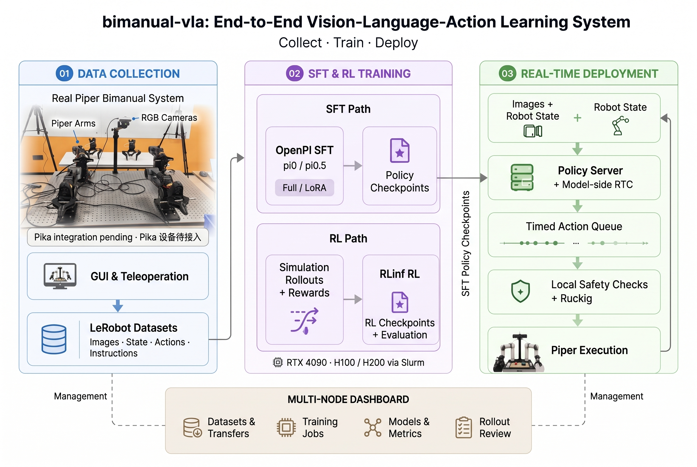

# 系统架构

## 三条主线

1. **数据采集：** Piper 执行臂状态、第三视角/腕部 RGB 与任务语言在工作站同步采集；输出 NPZ，经验证后导出 LeRobot v2.1。
2. **模型训练：** OpenPI π0 / π0.5 通过 SFT 学习示教数据；仿真 Dashboard 也提供依赖外部环境和算法 profile 的 RLinf 训练入口。
3. **实机运行：** Policy Server 通过 WebSocket 处理实时观测，返回动作 chunk；机器人客户端负责 chunk 时序、合同解码、本地安全检查与 Ruckig 指令发布。

## 数据面与管理面分离

| 数据面（实时） | 管理面（非实时） |
|---|---|
| 摄像头 + Piper 状态 → Policy WebSocket | Dashboard 管理数据集、训练、checkpoint、进程和评估视频 |
| 服务端 RTC 在 denoising 内处理 prefix | 监测、数据同步和多节点作业管理 |
| 客户端安全门、参考更新、Ruckig 伺服 | 实机与仿真使用独立 Dashboard 配置 |

Dashboard **不承担机器人观测的实时转发**，实时控制可靠性不能依赖网页刷新。

## 频率不是一个时钟

| 时钟 | 典型值 | 用途 |
|---|---:|---|
| GUI 采集 | 30 FPS（可配置） | 示教录制 |
| CLI teleop | 20 FPS（可配置） | 示教录制 |
| 相机帧 | 通常 30 FPS | Policy 图像观测 |
| 推理触发 | 默认约 4 Hz | 发起异步请求，实际随时延变化 |
| 客户端参考更新 | 默认 20 Hz | 消费动作目标与安全检查 |
| Ruckig 命令发布 | 默认 100 Hz | 经约束的低层目标发布 |

训练数据 FPS、Policy action FPS、推理触发频率和伺服频率**不可混为一谈**。具体数值受 checkpoint 元数据和启动参数约束。

## 代码地图

| 路径 | 功能 |
|---|---|
| [bimanual_vla/collection/](https://github.com/SUNNYsyy2005/bimanual-vla/tree/master/bimanual_vla/collection) | GUI、相机、遥操作、采集与回放 |
| [bimanual_vla/data/](https://github.com/SUNNYsyy2005/bimanual-vla/tree/master/bimanual_vla/data) | 数据验证、合同、转换、上传与分析 |
| [bimanual_vla/training/](https://github.com/SUNNYsyy2005/bimanual-vla/tree/master/bimanual_vla/training) | OpenPI 训练适配与 RTC 采样 |
| [bimanual_vla/deployment/](https://github.com/SUNNYsyy2005/bimanual-vla/tree/master/bimanual_vla/deployment) | Policy/RTC 客户端、运动规划与安全 |
| [server_4090/](https://github.com/SUNNYsyy2005/bimanual-vla/tree/master/server_4090) | Dashboard、API、作业及产物管理 |
| [bin/bimanual-vla](https://github.com/SUNNYsyy2005/bimanual-vla/blob/master/bin/bimanual-vla) | 统一 CLI 入口 |

架构细节和支持状态参阅 [项目 README](https://github.com/SUNNYsyy2005/bimanual-vla#system-overview)。
