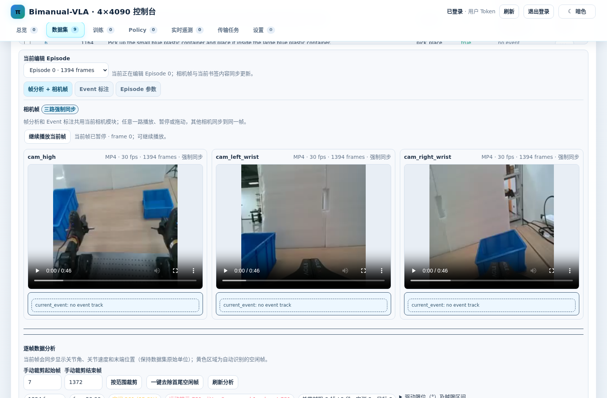

# Dashboard 与多节点管理

Dashboard 是**管理面**，不是运动控制回路本身。当前提供实机与仿真两套独立配置，后台代码复用，数据源筛选和作业类型不同。

## 功能导航

| 面板能力 | 典型用途 |
|---|---|
| Datasets | 浏览 episode/相机、编辑元数据、查看多节点副本、合并/截取/校验 |
| Training | 配置 SFT 或模拟器 RL 作业、分配 GPU/Slurm、监控日志曲线 |
| Checkpoints | 浏览训练权重、规范化统计、同步到 Policy 服务节点 |
| Evaluation | 管理 held-out 评测、仿真 rollout 及视频文件 |
| Deployment | 管理 Policy 进程、遥测、模型切换 |
| Settings / Nodes | 指定本地/远端存储根目录、运行目标和凭据 |

## 推荐使用顺序

1. 在运行节点按 [Dashboard 操作文档](https://github.com/SUNNYsyy2005/bimanual-vla/blob/master/server_4090/README.md) 配置并启动服务。
2. 在 Settings 检查本地数据/模型根目录和授权；避免直接使用文档历史示例中的固定内网 IP。
3. 上传原始 NPZ 或 LeRobot 数据、校验合同；检查服务端 dataset ID 与副本位置。
4. 选择真实/仿真工作区，配置训练与评估目标，核对 env、路径和 GPU。
5. 从任务日志、曲线与视频复核结果；同步 checkpoint 后再启动 Policy。
6. 对跨节点副本使用显式同步，**不要假设各节点共享文件系统或 Conda 环境**。

## 数据与训练资源

- [Dashboard 文档](https://github.com/SUNNYsyy2005/bimanual-vla/blob/master/server_4090/README.md)
- [仿真 Dashboard 完整手册](https://github.com/SUNNYsyy2005/bimanual-vla/blob/master/server_4090/SIMULATION_DASHBOARD.md)
- [REST API 使用指南](https://github.com/SUNNYsyy2005/bimanual-vla/blob/master/server_4090/API_USAGE.md)
- [Checkpoint 同步](https://github.com/SUNNYsyy2005/bimanual-vla/blob/master/server_4090/CHECKPOINT_SYNC.md)
- [实验产物和历史记录合同](https://github.com/SUNNYsyy2005/bimanual-vla/blob/master/docs/EXPERIMENT_ARTIFACT_CONTRACT.md)

**对外发布提示：** 不应在 Wiki 复制实际管理 Token、内网主机、SSH 私钥、服务器用户目录或集群账户。
