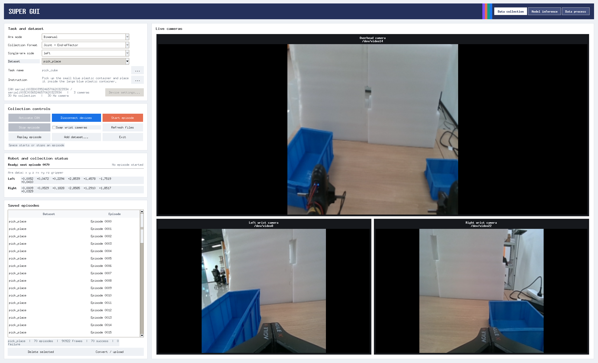

# 数据采集

## 采集前

1. 验证 CAN 反馈、左右臂映射、紧急停止与安全工作空间。
2. 确认第三视角及每只腕部相机均能预览，设备映射没有错位。
3. 设置任务语言、单臂/双臂、录制目录、schema、FPS。
4. 明确采集信号来源：teleop 的主/从臂混合 action 语义，与仅输出臂反馈的 fallback action 不相同。

## GUI 流程

~~~bash
conda activate dual_arm
bash start_gui.sh
~~~

在 GUI 中连接设备 → 检查实时状态/画面 → 设置任务 → 开始 episode → 停止录制 → 记录成功/失败 → 预览并检查 → 导出/上传。不要在不确定机器人姿态或连接状态时做硬件回放。

## CLI 遥操作示例

~~~bash
bin/bimanual-vla teleop-bimanual --record --schema joint --fps 20
~~~

也支持 teleop-single，以及 delivery schema；具体可用参数以命令 --help 和 [合同定义](https://github.com/SUNNYsyy2005/bimanual-vla/blob/master/docs/collection/PIPER_DATA_CONTRACT.md) 为准。

## 数据质量

- 语言指令和执行内容一致，episode 起止、成功标签准确。
- 相机有图、帧时间戳单调、机械臂状态完整、左右臂顺序正确。
- 漏帧、图像与状态时间偏差、意外撞击、复位异常，应单独标注或剔除。
- **回放不等于仿真：** 机器人硬件回放需有人值守、低风险范围内验证。

## 官方文档

[现场数据采集全流程](https://github.com/SUNNYsyy2005/bimanual-vla/blob/master/docs/collection/DATA_COLLECTION_GUIDE.md) · [GUI 操作手册](https://github.com/SUNNYsyy2005/bimanual-vla/blob/master/docs/collection/GUI_OPERATION_GUIDE.md) · [硬件回放说明](https://github.com/SUNNYsyy2005/bimanual-vla/blob/master/docs/collection/EPISODE_HARDWARE_REPLAY.md)。

采集完成后继续阅读 [[数据合同与导出|Dataset-and-Contracts]]。
