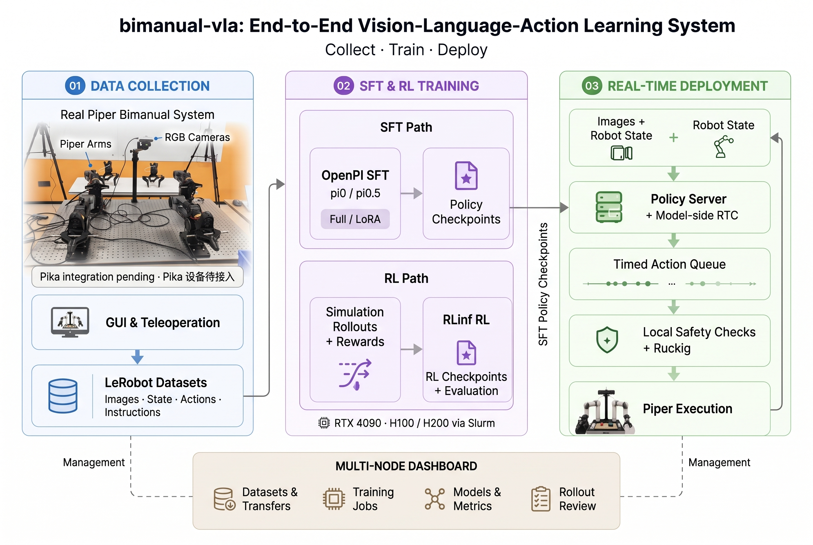
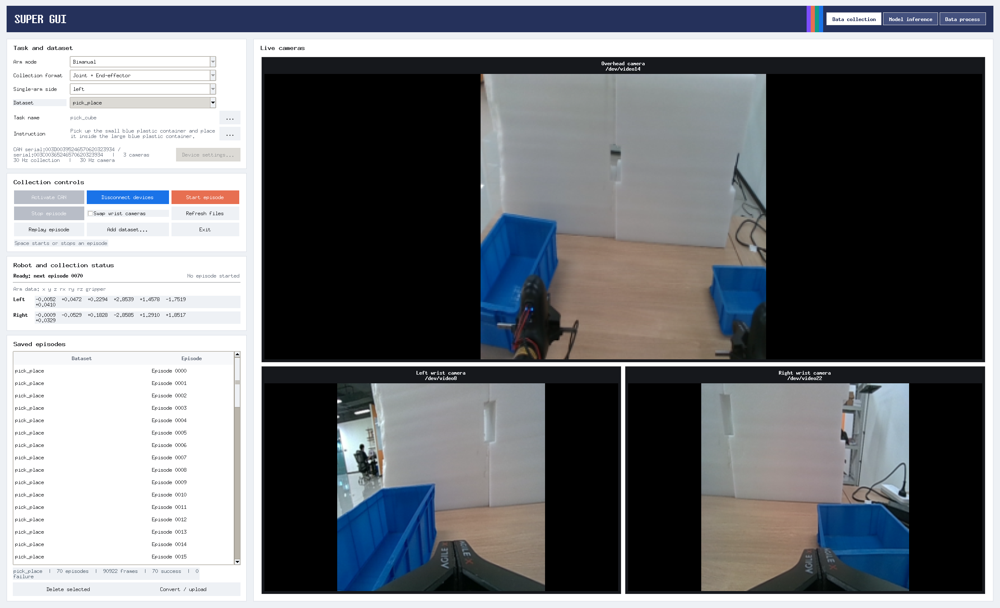
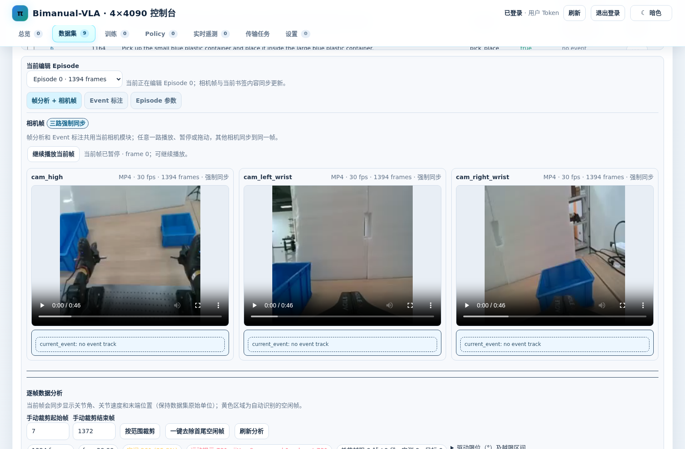

# bimanual-vla Wiki

> Piper 双臂视觉语言动作（VLA）项目：数据采集、LeRobot 数据集、OpenPI π0 / π0.5 训练、Dashboard 管理与实机 RTC 部署。

**项目仓库：** [bimanual-vla](https://github.com/SUNNYsyy2005/bimanual-vla) · **使用入口：** [[快速开始|Getting-Started]] · **演示与权重：** [[模型与演示|Models-and-Demos]]

## 你想做什么？

| 场景 | 推荐阅读 | 你将获得 |
|---|---|---|
| 第一次安装 | [[快速开始|Getting-Started]] → [[硬件与配置|Hardware-and-Configuration]] | Ubuntu、Conda、CAN、相机与最小检查 |
| 采集机器人示教 | [[数据采集|Data-Collection]] | GUI / teleop、回放、质量检查 |
| 将录制数据用于学习 | [[数据合同与导出|Dataset-and-Contracts]] | NPZ → LeRobot v2.1、joint / delivery 合同 |
| 训练策略 | [[训练与评测|Training-and-Evaluation]] | OpenPI SFT、仿真 RLinf、检查点管理 |
| 让策略连接真实 Piper | [[实机部署与安全|Real-Robot-Deployment]] | WebSocket Policy、RTC、Ruckig、影子模式 |
| 使用服务器管理面板 | [[Dashboard 与多节点|Dashboard-and-Multi-Node]] | 多节点数据/训练/评测/模型管理 |
| 查错误 | [[故障排查|Troubleshooting]] | CAN、摄像头、schema、网络和执行安全 |
| 理解代码设计 | [[系统架构|Architecture]] | 数据面/管理面、目录、频率和职责 |

## 核心工作流

~~~text
Piper + RGB 相机
  → 采集示教 / 回放检查
  → 原始 NPZ + v3 数据合同
  → LeRobot v2.1 / train-test split
  → OpenPI π0 / π0.5 SFT
  → Policy Server (WebSocket)
  → RTC action chunks / 本地安全检查
  → Ruckig 参考规划与 Piper 执行
~~~

仿真训练/评测是另一条路径：**仿真 Dashboard → RLinf 环境与算法配置 → Rollout、指标与评估视频**，不等同于直接对真实机械臂执行 RL。

## 开源协议

本项目原创源代码与文档采用 [Apache License 2.0](https://github.com/SUNNYsyy2005/bimanual-vla/blob/master/LICENSE)（另有注明的部分除外），第三方适配及署名参见 [NOTICE](https://github.com/SUNNYsyy2005/bimanual-vla/blob/master/NOTICE)。外部发布的数据集、模型权重以各自发布页面的授权为准。

## 当前功能与边界

- **可用：** 单臂/双臂 Piper 数据采集与回放、joint/delivery 表示、LeRobot 转换、OpenPI SFT、Dashboard 管理、WebSocket RTC 客户端、Ruckig 控制和安全门。
- **按配置提供：** RLinf 仿真训练与评测、Slurm H100/H200、多服务器数据/权重同步。
- **尚未接入：** 架构图里的 Pika 设备；不应把它当作现成的采集接口。
- **安全提示：** 默认演示命令优先选择不执行机器人的 shadow 模式；真正执行前必须校验机械臂、工作空间和 Policy 合同。

## 图片和演示

2026-10-27 真机抓放演示见 [[模型与演示|Models-and-Demos]]。

---

**版本说明：** 本 Wiki 基于仓库 master 分支截至 2026-11-01 的公开文档整理。细节以各页链接的源文件、代码与实际 --help 输出为准。
