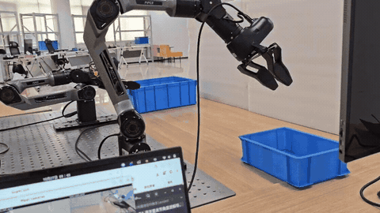

# 已发布模型、数据集与演示

## 真机演示（2026-10-27）

**任务：** “Pick up the small blue plastic container and place it inside the large blue plastic container.”

[查看原速真机演示视频](https://huggingface.co/SUNNYsyy2005/pi05_pick_place_clean_joint_20261025_20k/resolve/main/media/pick-place-real-robot-20261027.mp4)

## Hugging Face 发布资源

| 表示 | 示教数据集 | π0.5 权重 |
|---|---|---|
| 双臂 joint | [pick_place_clean_joint_20261025](https://huggingface.co/datasets/SUNNYsyy2005/pick_place_clean_joint_20261025) | [joint · 20k](https://huggingface.co/SUNNYsyy2005/pi05_pick_place_clean_joint_20261025_20k) |
| 双臂 delivery (EEF) | [pick_place_clean_delivery_20261025](https://huggingface.co/datasets/SUNNYsyy2005/pick_place_clean_delivery_20261025) | [delivery · 20k](https://huggingface.co/SUNNYsyy2005/pi05_pick_place_clean_delivery_20261025_20k) |

两份数据是**相同真实示教的不同动作表示**，均记录为 90 episodes / 69,905 frames（30 FPS），grouped split 为 81 train / 9 held-out。发布权重是 **20,000 步 SFT 训练的 π0.5 推理 checkpoint**，包含参数、norm stats 与动作合同，不包含可精确继续训练的优化器状态。

使用前核对数据集卡和模型卡的运行环境、state/action 表示、相机键名、action FPS、归一化统计及 RTC 设置，**不可简单替换任意模型后直接执行机器人**。

详细信息：[README 资源说明](https://github.com/SUNNYsyy2005/bimanual-vla#released-models-and-datasets) · [[训练与评测|Training-and-Evaluation]] · [[实机部署与安全|Real-Robot-Deployment]]。
