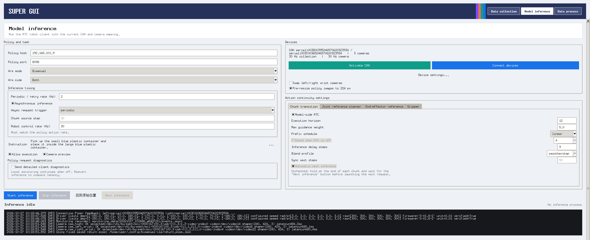

# 实机部署与安全

**顺序原则：先影子模式检查，再在现场监督下测试真实执行。**

## 运行链路

~~~text
Piper state + RGB + instruction
  → WebSocket Policy (OpenPI π0 / π0.5)
  → model-side RTC / action chunk
  → client decoding and scheduling
  → age / workspace / joint / gripper / IK safety checks
  → 20 Hz reference updates
  → optional 100 Hz Ruckig command publishing
~~~

RTC 指的是 **Real-Time Chunking**，会在模型 denoising 内使用 prefix 做时延对齐，并不只是客户端插值。低层 Ruckig 轨迹整形与模型 RTC 是不同机制。

## 首次连接：影子模式

假设 Policy Server 已依据 Dashboard/部署文档成功运行：

~~~bash
export BIMANUAL_VLA_POLICY_HOST="<policy-server-host>"

bin/bimanual-vla rtc-client   --host "$BIMANUAL_VLA_POLICY_HOST"   --port 8000   --arm-mode bimanual   --arm-side both   --left-can can0 --right-can can1   --cam-high-device auto   --cam-left-wrist-device auto   --cam-right-wrist-device auto   --instruction "pick up the cube"   --hz 4   --control-hz 20   --rtc-enabled
~~~

此例**没有** --allow-execution，不应发布实际动作。先确认 checkpoint 的相机输入、state/action schema、normalize 统计、元数据 FPS、chunk horizon 和遥测表现。

## 真机执行前必须确认

- 急停/操作员与低风险测试场地就绪，CAN 左右映射正确，机械臂反馈新鲜。
- policy 维度/单位/坐标系与采集合同一致；command limits、workspace 和夹爪边界适配当前物理系统。
- 不存在相互冲突的外部控制流；GUI、teleop、RTC 不应抢占同一执行通道。
- 测试定位、关节速度/加速度/jerk、tracking error、延迟尖峰与新旧 chunk 切换。
- **仅在确认条件后**，现场人员才根据完整部署文档决定是否显式启用 --allow-execution；该开关不绕过安全检查。

## 时序与抖动

- 默认请求触发是 periodic（约 4 Hz）；chunk_step 模式可按已接受 chunk 的步数触发。
- reference 更新默认约 20 Hz；Ruckig 发布默认约 100 Hz；Policy action rate 由元数据指定，可不同于二者。
- 过强平滑、blend 或预瞄会改善部分指令连续性，却可能引入延迟/跟踪偏差；取消整形则可能暴露抖动。
- 不要将训练期 RTC、客户端 chunk blend 和 Ruckig 伺服视为同一个参数。

**操作说明：** [RTC 客户端权威指南](https://github.com/SUNNYsyy2005/bimanual-vla/blob/master/docs/deployment/RTC_CLIENT_GUIDE.md) · [局部 IK 参数](https://github.com/SUNNYsyy2005/bimanual-vla/blob/master/docs/deployment/LOCAL_IK_PARAMETERS.md) · [安全阈值说明](https://github.com/SUNNYsyy2005/bimanual-vla/blob/master/docs/deployment/SAFETY_THRESHOLDS_8_3_64EPS.md)。
